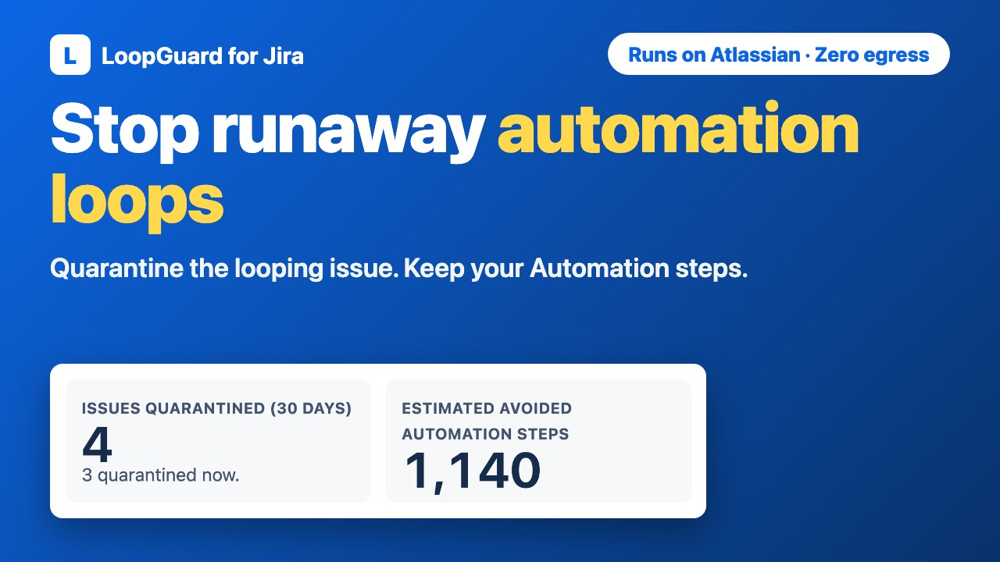
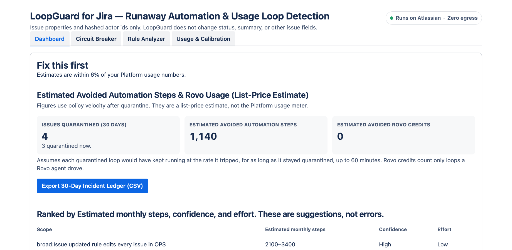
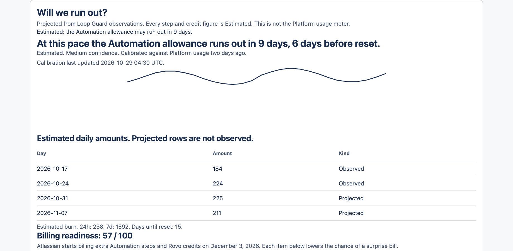
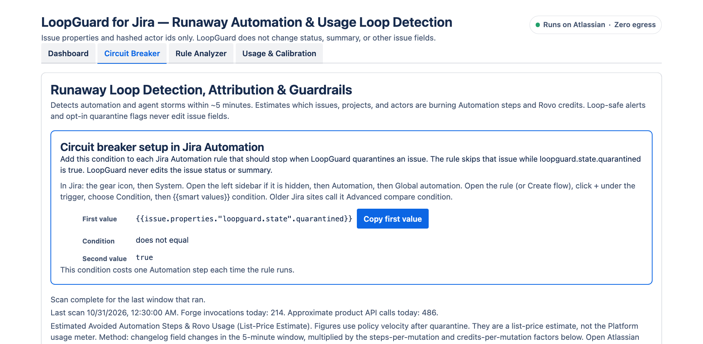
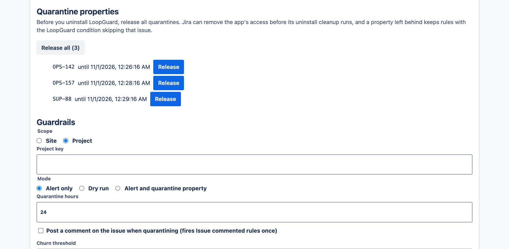
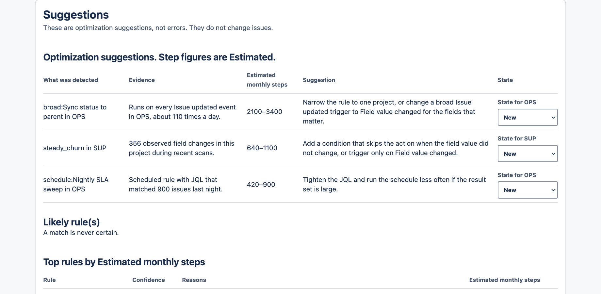
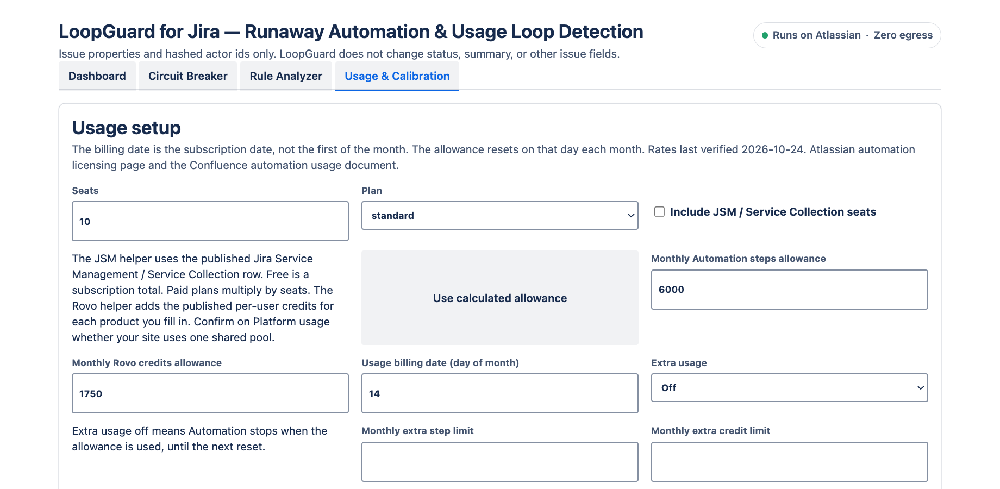

# LoopGuard for Jira — Documentation & Support

**Developed by SentientApps.** Find runaway Jira Automation loops, quarantine the looping issue, and keep your Automation and Rovo allowances. LoopGuard never edits your issues' status, summary, labels, or other fields.

LoopGuard runs on Atlassian Forge with zero egress: no external servers, and your data stays in your Atlassian site. See the [Privacy Policy](PRIVACY.md).

## 🎬 Demo video

▶️ **[Watch the 3-minute walkthrough on YouTube](https://youtu.be/GRBHq0NR5rs)** (English captions)

## Why it matters

A loop starts when one rule edits an issue and that edit triggers another rule, again and again. Every pass spends Automation steps, and Rovo agents can spend credits the same way. From **December 3, 2026**, Atlassian bills extra Automation steps and Rovo credits, so a loop left running overnight now costs money.

## 📸 Screenshots

Taken with sample data.

**Dashboard** — issues quarantined, estimated avoided Automation steps and Rovo credits, and what to fix first.

**Forecast and billing readiness** — when your Automation allowance is likely to run out, and what to set up before billing starts.

**Circuit Breaker** — the Jira Automation condition to add to your rules, with attributed activity.

**Quarantine and guardrails** — release one issue or all of them, and choose per project: Alert only, Dry run, or Alert and quarantine.

**Rule Analyzer** — import your Automation rules export, preview a rule's cost, and get ranked suggestions.

**Usage & Calibration** — allowances, billing day, extra-usage decision, and calibration against your Platform usage numbers.

## 🚀 Getting started

1. **Install** LoopGuard for Jira from the Atlassian Marketplace. New installs **only alert**; nothing is quarantined until you opt in.
2. **Open LoopGuard:** Jira settings (gear icon) → **Apps** → **LoopGuard**.
3. **Add the condition to your rules.** In Jira: the gear icon → **System** → open the left sidebar if it is hidden → **Automation** → **Global automation**. Open a rule, click **+** under the trigger, choose **Condition**, then **{{smart values}} condition** (older sites call it *Advanced compare condition*), and enter:
   - **First value:** `{{issue.properties."loopguard.state".quarantined}}`
   - **Condition:** does not equal
   - **Second value:** `true`

   The **Circuit Breaker** tab has a button that copies the first value.
4. **Turn on quarantine for a project.** On the **Circuit Breaker** tab → **Guardrails**: choose **Project**, enter the project key, choose **Alert and quarantine property**, set the quarantine hours, and click **Save guardrails**. Try **Dry run** first if you want to see what would be quarantined.

## ⚙️ How it works

- **Real-time circuit breaker.** LoopGuard counts updates per issue. Six updates to one issue within a minute, or a field flipping back and forth, trips the breaker.
- **Quarantine.** On a project set to *Alert and quarantine*, LoopGuard sets one issue property, `loopguard.state` (`quarantined: true`). Rules that include the condition above skip that issue. Optionally, LoopGuard posts one comment explaining why (off by default; it fires *Issue commented* rules once).
- **Release.** Release an issue from the **Circuit Breaker** tab when the cause is fixed, or let the quarantine expire after the hours you chose. **Release all** clears every quarantined issue at once.
- **5-minute scan.** A scheduled scan attributes changes to issues, projects, and actors, and raises alerts against your normal activity for that hour and weekday.
- **Guardrails** per project: Alert only (default), Dry run, or Alert and quarantine; allowlisted accounts and projects; and a window for planned bulk jobs.

## ⚠️ Good to know

- Quarantine only stops rules that **include the LoopGuard condition**. Each condition check costs one Automation step when the rule runs.
- Jira does not tell apps which automation rule made a change, so several rules can appear as the same actor.
- During heavy bursts, Jira can deliver update events a few seconds late, so a fast loop may run a few more times before it is quarantined.
- All step and credit figures are **estimates**, not Atlassian's Platform usage meter.
- **Before uninstalling, click Release all** on the Circuit Breaker tab. Jira can remove the app's access before its uninstall cleanup runs, and a property left behind keeps rules with the condition skipping that issue. To remove one by hand: `DELETE /rest/api/3/issue/{issueKey}/properties/loopguard.state`.

## 🆘 Support

Open an issue in this repository: **[Report a problem or ask a question](../../issues/new)**. Please include your Jira site URL, what you expected, and what happened. Don't paste personal data or secrets into issues.

## 🔒 Privacy & security

LoopGuard stores only what it needs (issue IDs and keys, project keys, Atlassian account IDs of actors, counts, and your settings) inside Atlassian's Forge storage. Full details: [PRIVACY.md](PRIVACY.md).
